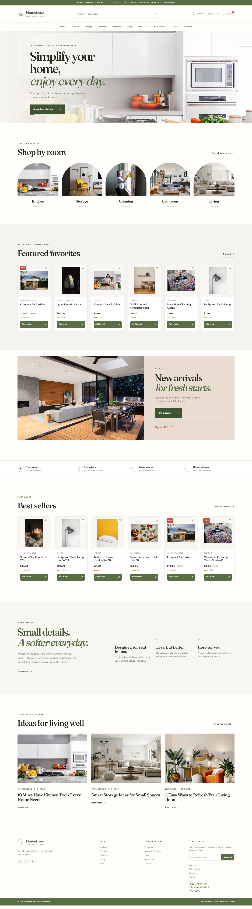
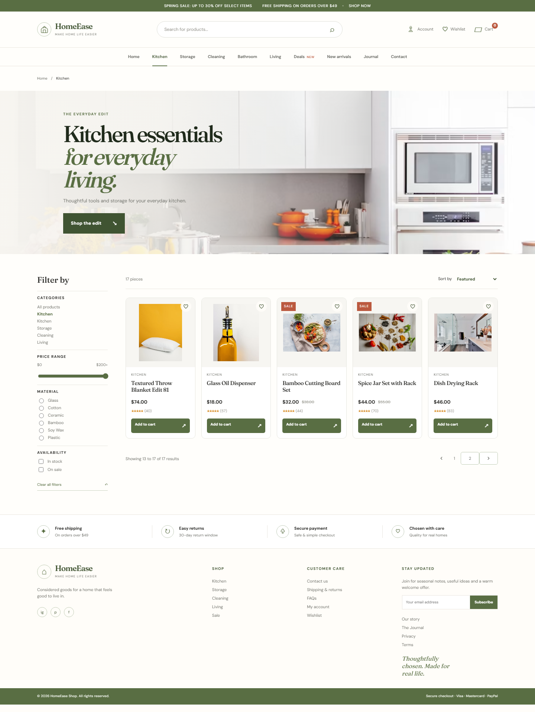
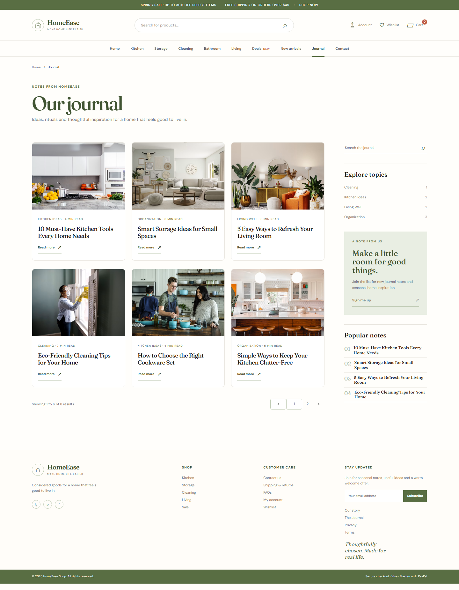
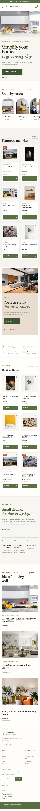
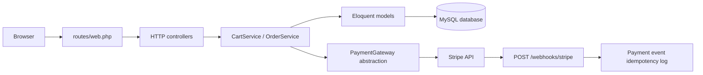

<div align="center">

# HomeEase Shop

**Thoughtfully designed essentials for everyday living.**

A Laravel-powered home and living storefront with a calm editorial interface, database-backed commerce, customer accounts, journal content, and a custom admin surface.

<p>
  <a href="#product-preview">Preview</a> |
  <a href="#features">Features</a> |
  <a href="#architecture">Architecture</a> |
  <a href="#getting-started">Getting started</a> |
  <a href="#roadmap">Roadmap</a>
</p>

<p>
  
  
  
  
  
</p>

</div>

> [!IMPORTANT]
> The current source implements a home and living **e-commerce storefront**. It does not currently contain domestic staffing, service-provider matching, job posting, or household service workflows. Those ideas should be treated as future product scope rather than completed functionality.

## About HomeEase

HomeEase Shop is a full-stack Laravel application for discovering and purchasing practical home products. It combines a product catalog, search and filtering, session and account carts, checkout, inventory, payments, customer accounts, and a journal-style content experience in one server-rendered application.

The seeded experience currently includes 120 illustrative products across eight room and lifestyle categories, eight journal posts, promotional coupons, product variants, inventory records, and the supporting commerce data model.

## Product preview

The screenshots below are captured from the repository's Phase 4 responsive visual QA set.

<table>
  <tr>
    <td width="50%"></td>
    <td width="50%"></td>
  </tr>
  <tr>
    <td align="center"><sub>Homepage</sub></td>
    <td align="center"><sub>Catalog and filtering</sub></td>
  </tr>
  <tr>
    <td colspan="2"></td>
  </tr>
  <tr>
    <td colspan="2" align="center"><sub>Journal listing and editorial content</sub></td>
  </tr>
</table>

<p align="center">
  
</p>

<p align="center"><sub>Mobile layout at 390px</sub></p>

## Features

### Storefront experience

- Homepage with hero content, room categories, featured products, best sellers, promotional content, benefits, newsletter capture, and journal highlights.
- Catalog pages for Kitchen, Storage, Cleaning, Bathroom, Living, Dining, Decor, and Home Appliances.
- Product detail pages with pricing, sale pricing, stock state, ratings, product imagery, variants, and wishlist actions.
- Search, category navigation, sorting, price and material filters, availability filters, and pagination.
- Responsive navigation, mobile filter drawer, quantity controls, empty states, accessible labels, and responsive layouts.

### Customer and commerce workflows

- Guest and authenticated carts backed by the database, with guest-cart merging after login.
- Wishlist toggling and a persisted newsletter subscription flow.
- Registration, login, logout, password reset routes, and inactive-account rejection.
- Authenticated account pages for profile, password, addresses, order history, and order details.
- Transactional checkout with server-side totals, standard and express shipping, coupon validation, inventory locking, payment reservations with expiry, order items, and shipment creation only after payment succeeds.
- Payment gateway abstraction with Stripe support and a fake gateway for automated tests.
- Stripe webhook signature validation, idempotent payment-event reconciliation, failed/expired reservation release, and refund state handling.

### Admin and content management

- Server-authorized custom admin area under `/admin`, protected by authentication and the `staff`, `admin`, or `super_admin` roles.
- Product, product image, variant, category, brand, and inventory management.
- Order status and shipment controls, with audit records for administrative changes.
- Journal post and journal category CRUD, publishing state, archive actions, and sanitized rich text.
- Customer, coupon, banner, media, newsletter, store setting, and audit-log surfaces.

## Tech stack

| Layer | Technology | Role |
| --- | --- | --- |
| Runtime | PHP 8.3+ | Application runtime |
| Framework | Laravel 13 | Routing, HTTP, authentication, validation, ORM, migrations, and sessions |
| Views | Blade | Server-rendered storefront, account, checkout, journal, and admin views |
| Styling | Custom CSS; Tailwind CSS 4 Vite plugin configured | Responsive visual system and design tokens |
| Asset tooling | Vite 8, Laravel Vite Plugin | Development and production asset bundling |
| Database | MySQL configuration with Eloquent ORM | Catalog, accounts, carts, orders, payments, content, and admin data |
| Payments | Stripe gateway plus fake test gateway | Payment intents and signed webhook processing |
| Testing | PHPUnit 12 and Playwright | Feature/unit coverage and responsive browser smoke checks |

## Architecture

HomeEase follows a conventional Laravel request flow. Storefront and admin requests enter through `routes/web.php`, controllers coordinate application actions, domain services handle cart and order rules, and Eloquent models persist state in the database.



Important boundaries in the implementation:

- `CartService` owns guest and authenticated cart identity, cart merging, variant-aware quantities, and stock checks.
- `OrderService` calculates totals, validates coupons, locks inventory, creates order records, and coordinates payment creation inside a transaction.
- `PaymentGateway` separates Stripe from the fake gateway used by the test environment.
- `EnsureAdmin` applies server-side role authorization to every admin route.

## Project structure

```text
app/
+-- Console/Commands/       Custom Artisan commands
+-- Http/Controllers/       Storefront, auth, account, checkout, payment, and admin actions
+-- Http/Middleware/        Admin authorization middleware
+-- Models/                 Eloquent domain models
+-- Services/               Cart, order, and payment services
\-- Providers/              Application service providers
database/
+-- factories/              Test data factories
+-- migrations/             Core, catalog, commerce, auth, and admin schemas
\-- seeders/                HomeEase catalog and demo commerce data
resources/
+-- css/                    Storefront design system and responsive styles
+-- js/                     Small interaction behaviors
\-- views/                  Blade layouts, pages, partials, account, and admin screens
routes/web.php              Web routes and middleware boundaries
screenshots/                Responsive visual QA captures
tests/                      PHPUnit feature/unit tests and Playwright browser checks
docs/                       Asset audit and supporting project documentation
```

## Route map

| Area | Routes |
| --- | --- |
| Storefront | `/`, `/shop`, `/search`, `/categories/{slug}`, `/products/{product}`, `/blog` |
| Catalog shortcuts | `/kitchen`, `/storage`, `/cleaning`, `/bathroom`, `/living`, `/dining`, `/decor`, `/home-appliances` |
| Commerce | `/cart`, `/wishlist`, `/checkout`, `/webhooks/stripe` |
| Customer account | `/account`, `/account/profile`, `/account/addresses`, `/account/orders` |
| Administration | `/admin`, `/admin/products`, `/admin/inventory`, `/admin/orders`, `/admin/blog-posts`, and related resource modules |

## Getting started

### Prerequisites

- PHP 8.3 or newer
- Composer
- Node.js and npm
- A MySQL-compatible database server

### 1. Install the application

Clone the repository using your actual Git remote, then run:

```powershell
composer install
npm install
```

### 2. Configure the environment

Create the local environment file and generate an application key:

```powershell
Copy-Item .env.example .env
php artisan key:generate
```

Update `.env` with the credentials for a local MySQL database. The checked-in example uses the `homeease_shop` database name and database-backed sessions, cache, and queue configuration. Keep payment credentials out of source control.

For local Stripe checkout and webhook handling, configure `STRIPE_SECRET` and `STRIPE_WEBHOOK_SECRET`. Automated tests use the fake payment driver configured in `phpunit.xml`.

### 3. Prepare the database

Create the configured database, then run migrations and seed the catalog:

```powershell
php artisan migrate --seed
```

### 4. Build and run

```powershell
npm run build
php artisan serve
```

For frontend development with hot reload, use `npm run dev` in a separate terminal.

### 5. Create an administrator

Use the project command and follow its prompts. It does not hardcode or print the generated password:

```powershell
php artisan homeease:super-admin
```

## Testing

Run the PHPUnit suite with the test database configured in `phpunit.xml`:

```powershell
php artisan test --compact
```

When MySQL is not available, use the bounded local SQLite smoke configuration for application-level regression only:

```powershell
php artisan test --configuration=phpunit.sqlite.xml --filter="PaymentWebhookTest|OrderAndPaymentTest"
```

This does not replace the MySQL integration suite; it prevents a missing local MySQL service from being mistaken for an application deadlock.

The browser smoke suite checks the homepage, Kitchen catalog, and Journal listing across six viewport widths and verifies that the category paginator remains usable:

```powershell
npx playwright test tests/browser/phase3.spec.cjs --browser=chromium --workers=1
```

Set `HOMEEASE_BASE_URL` when the application is running on a different local address. The browser suite defaults to `http://127.0.0.1:8012`.

## Data and asset notes

The seeded catalog is intentionally illustrative. Product and journal imagery currently uses provisional Unsplash CDN URLs, including reused lifestyle imagery. This is suitable for local development and visual composition, but it is not a completed production asset or rights register.

See the [image asset manifest](docs/IMAGE_ASSET_MANIFEST.md) for the audit, source references, and replacement queue. The [master verification report](HOMEEASE_MASTER_REPORT.md) records the broader implementation status and remaining production work.

## Roadmap

- [x] Catalog browsing, product detail, search, filtering, sorting, and pagination.
- [x] Guest and authenticated cart flows with inventory-aware quantities.
- [x] Customer authentication, account management, addresses, and order history.
- [x] Transactional checkout, coupons, shipping calculation, inventory reservations, payment abstraction, and compensation paths.
- [x] Custom role-protected admin and journal/content management surfaces.
- [x] Responsive visual QA captures for the core storefront pages.
- [ ] Configure Stripe sandbox credentials and run provider-backed payment verification.
- [ ] Configure production mail delivery and complete password-reset delivery verification.
- [ ] Replace provisional catalog imagery with rights-verified, localized assets.
- [ ] Harden production deployment settings, including a non-root database user, HTTPS cookies, `APP_DEBUG=false`, and dedicated queue/cache infrastructure.
- [ ] Align and implement any future home-services or domestic-staffing product scope if that remains the intended direction.

## Contributing, security, and license

This repository does not currently include `CONTRIBUTING.md` or `SECURITY.md`. For changes, follow the existing Laravel structure, add meaningful regression coverage for behavior changes, and keep secrets out of commits.

There is no standalone `LICENSE` file in the repository. Confirm and add the intended license before publishing the project as an open-source package.

<div align="center">

<sub>HomeEase Shop - Thoughtfully chosen. Made for real life.</sub>

<br>

<a href="#homeease-shop">Back to top</a>

</div>
